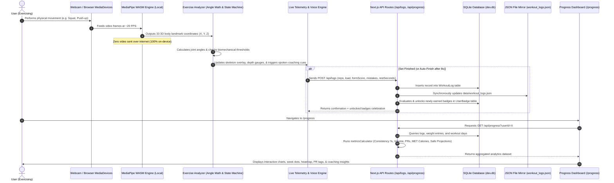
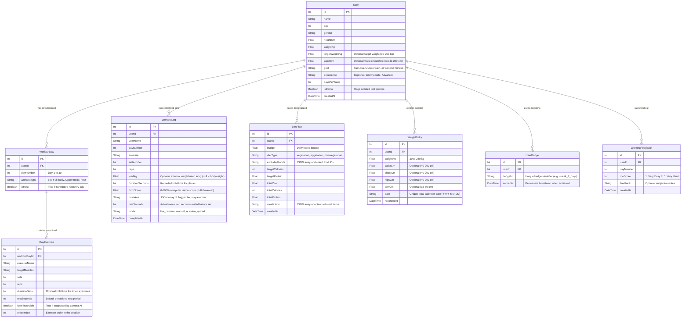

# FitForm Technical Architecture & Technology Stack Guide

> **Audience:** College Academic Evaluators, Examination Panels, and Technical Assessors.  
> **Purpose:** This document provides an exhaustive, plain-language explanation of the system architecture, underlying technologies, data pipelines, database structure, and current boundaries of the **FitForm** project.

---

## 1. Complete Technology Stack & Libraries Actually Used

Every library and dependency listed below is installed in [`package.json`](file:///c:/Users/Sanskar/Desktop/cep2/package.json) and actively used in the running software. No unused or imaginary libraries are documented.

### Core Architecture & Application Framework
| Technology / Library | Exact Version | Plain-Language Purpose |
| :--- | :--- | :--- |
| **Node.js** | `>= 20.0.0` | The foundational JavaScript server runtime environment that executes all backend tasks, build tools, and local scripts. |
| **Next.js** | `14.2.29` | The central full-stack web framework that serves frontend web pages and powers server-side API endpoints in one unified system. |
| **React** | `18.3.1` | The component-based user interface library used to build interactive, state-driven screens and dynamic controls. |
| **React DOM** | `18.3.1` | The bridge package that renders React components into standard HTML elements inside the user's web browser. |
| **TypeScript** | `5.5.2` | A strictly-typed superset of JavaScript that prevents bugs, typos, and mismatched data types during development before the code runs. |

### Computer Vision & On-Device Artificial Intelligence
| Technology / Library | Exact Version | Plain-Language Purpose |
| :--- | :--- | :--- |
| **@mediapipe/tasks-vision** | `0.10.14` | Google's computer vision package that processes live webcam frames and extracts 33 3D skeletal body landmark coordinates in real-time. |
| **MediaPipe WASM Engine** | `0.10.14` | High-performance WebAssembly binaries bundled locally in [`public/mediapipe/wasm/`](file:///c:/Users/Sanskar/Desktop/cep2/public/mediapipe/wasm/) to run neural networks inside the browser CPU/GPU without external servers. |
| **Pose Landmarker Model** | `Lite (5.5 MB)` | A pre-trained neural network file stored locally in [`public/mediapipe/models/pose_landmarker_lite.task`](file:///c:/Users/Sanskar/Desktop/cep2/public/mediapipe/models/pose_landmarker_lite.task) that recognizes human joint locations locally with zero network calls. |

### Database & Persistent Storage
| Technology / Library | Exact Version | Plain-Language Purpose |
| :--- | :--- | :--- |
| **SQLite** | `3.x` (embedded) | A serverless, zero-configuration relational database stored as a single local file ([`prisma/dev.db`](file:///c:/Users/Sanskar/Desktop/cep2/prisma/dev.db)) ensuring complete privacy and offline operation. |
| **Prisma ORM** | `5.22.0` | The database toolkit and schema migration utility that translates database records into strongly-typed TypeScript objects. |
| **@prisma/client** | `5.22.0` | The auto-generated database client used by backend API routes to safely read and write database records without raw SQL vulnerabilities. |

### User Interface, Design & Animations
| Technology / Library | Exact Version | Plain-Language Purpose |
| :--- | :--- | :--- |
| **Tailwind CSS** | `3.4.1` | A modern utility-first stylesheet framework used to construct the clean, glassmorphic, responsive user interface. |
| **PostCSS** | `8.4.38` | The CSS processing tool that parses Tailwind classes and transforms them into standard browser-compatible styling. |
| **Framer Motion** | `11.11.17` | A physics-based animation library that creates smooth card entrances, milestone modals, and respects the user's reduced-motion accessibility preference. |
| **Lucide React** | `0.460.0` | An icon library providing clean, accessible vector icons for fitness metrics, equipment, timers, and navigation. |
| **Next Themes** | `0.4.4` | A lightweight theme provider that manages dark and light modes cleanly without screen flickering on page reload. |
| **Recharts** | `^3.10.1` | A SVG charting library used to render responsive charts for form progression, bodyweight history, weekly volume, and technique mistakes. |

### Native Browser Web APIs (Zero-Installation Built-in Standards)
| Browser Standard API | Platform | Plain-Language Purpose |
| :--- | :--- | :--- |
| **WebRTC MediaDevices** | HTML5 / Browser | Captures live camera frames from the user's webcam with explicit security permission prompts. |
| **Web Speech API (`speechSynthesis`)** | HTML5 / Browser | Converts written coaching cues into spoken audio guidance in real-time so the user does not need to look at the screen while exercising. |
| **Web Audio API (`AudioContext`)** | HTML5 / Browser | Synthesizes pleasant countdown beeps and rest-completion chime tones dynamically in code without loading audio files. |
| **Vibration API (`navigator.vibrate`)** | Mobile Browser | Delivers tactile vibration pulses to mobile phones during the final 3-2-1 rest countdown ticks. |
| **Local Storage (`localStorage`)** | HTML5 / Browser | Remembers user interface preferences (such as dark mode, voice volume, chosen rest seconds, and last-used weights) between visits. |

### Quality Assurance, Testing & Administrative Utilities
| Tool / Library | Exact Version | Plain-Language Purpose |
| :--- | :--- | :--- |
| **Vitest** | `1.6.0` | A lightning-fast automated test runner that executes 86 automated unit and regression tests verifying pose math, streak logic, and calorie formulas. |
| **ESLint** | `8.57.0` | An automated code linter that enforces high code quality, eliminates dead variables, and maintains standard programming patterns. |
| **eslint-config-next** | `14.2.29` | Next.js-specific rule configurations for ESLint ensuring correct server and client component usage. |
| **isomorphic-git** | `1.27.0` | A pure JavaScript Git library used by project automation scripts to create version control commits consistently on any operating system. |

---

## 2. Directory & Folder Structure Explained Simply

The codebase is organized following clean architectural separation of concerns:

```
cep2/
├── data/                               # Backup mirror folder
│   └── workout_logs.json               # Auto-synchronized human-readable JSON copy of all workout logs
├── prisma/                             # Database definition & storage
│   ├── schema.prisma                   # Single source of truth for all database tables and relations
│   └── dev.db                          # The SQLite database file holding all user data
├── public/                             # Public static assets served to browsers
│   └── mediapipe/                      # Local AI bundle (zero cloud dependency)
│       ├── models/                     # pose_landmarker_lite.task (5.5 MB neural network)
│       └── wasm/                       # WebAssembly runtime scripts for browser execution
├── src/                                # Application source code
│   ├── app/                            # Next.js App Router (Pages and API Routes)
│   │   ├── page.tsx                    # Landing / Home screen
│   │   ├── onboarding/page.tsx         # User profile setup & biometric goal questionnaire
│   │   ├── plan/                       # 30-Day Workout Program Timeline
│   │   │   ├── page.tsx                # Program overview with day cards (Days 1–30)
│   │   │   └── [day]/page.tsx          # Specific day details, exercise lists, and sets breakdown
│   │   ├── workout/                    # Live Workout Experience
│   │   │   └── [day]/page.tsx          # Interactive set tracker, camera checker, and rest countdown
│   │   ├── diet/page.tsx               # Budget-friendly Indian diet planner & meal macro optimizer
│   │   ├── progress/page.tsx           # Personal analytics dashboard (streaks, PRs, body charts, badges)
│   │   ├── logs/page.tsx               # Full audit table of all completed workout sets with CSV/JSON export
│   │   ├── dev/pose-test/page.tsx      # Developer pose simulation studio for camera-free verification
│   │   └── api/                        # Backend Server Endpoints (REST APIs)
│   │       ├── users/route.ts          # Profile creation and biometric updates
│   │       ├── plan/route.ts           # 30-Day personalized routine generation
│   │       ├── logs/route.ts           # Workout set logging, rest timer updates, and exports
│   │       ├── weight/route.ts         # Bodyweight & tape measurement check-ins
│   │       ├── diet/route.ts           # Diet plan generation, meal swaps, and saving
│   │       ├── progress/route.ts       # Unified statistics, streaks, volume, and badge calculations
│   │       ├── workout/feedback/       # Post-workout subjective difficulty rating (RPE 1–5)
│   │       └── dev/demo-data/          # Developer tool for loading and clearing isolated demo profiles
│   ├── components/                     # Reusable User Interface Components
│   │   ├── pose/                       # Live camera viewport, skeleton canvas, and telemetry gauges
│   │   ├── workout/                    # Rest timer ring, summary celebration card, and voice modal
│   │   ├── progress/                   # Heatmap, achievement badge wall, charts, and check-in cards
│   │   ├── voice/                      # Audio voice settings modal and tone preview controls
│   │   ├── Navbar.tsx                  # Top navigation bar with active route pills
│   │   ├── ThemeToggle.tsx             # Dark / Light mode switch
│   │   └── AnimatedBackground.tsx      # Smooth particle background (auto-pauses during workouts)
│   └── lib/                            # Business Logic, Mathematical Engines & Science Rules
│       ├── pose/                       # Pose math, joint angles, EMA filters, and exercise analyzers
│       │   ├── analyzers/              # Self-contained analyzers (Squat, Push-Up, Curl, Lunge, Plank)
│       │   ├── angleMath.ts            # Trigonometric angle calculations between 3D body points
│       │   ├── exerciseConfig.ts       # Central dictionary of all joint angle thresholds and timings
│       │   └── types.ts                # TypeScript contracts for all exercise analyzers
│       ├── progress/                   # Deterministic Analytics & Biometric Calculators
│       │   ├── metricsCalculator.ts    # Consistency, PRs, volume, error shifts, and safe projections
│       │   ├── streakCalculator.ts     # Local timezone-aware streak rules and 7-day week dots
│       │   ├── badgesConfig.ts         # Evaluation criteria for all 14 milestone badges
│       │   ├── badgeChecker.ts         # Automatic badge unlock evaluator
│       │   └── metValues.ts            # Compendium of Physical Activities MET reference table
│       ├── voice/                      # Voice & Speech Coaching System
│       │   ├── speechScheduler.ts      # Spoken coaching queue with cooldowns and priority sorting
│       │   ├── phrases.ts              # Concise coaching cues under 8 words
│       │   └── soundEffects.ts         # Web Audio synthesizer for countdown beeps and chimes
│       ├── workout/                    # Workout generation rules and exercise database
│       ├── diet/                       # Indian food nutrition database and macro calculator
│       ├── prisma.ts                   # SQLite Prisma database singleton
│       └── syncLogs.ts                 # Real-time synchronization tool for data/workout_logs.json
├── tests/                              # Automated Unit and Integration Test Suites
│   ├── realMetrics.test.ts             # Tests for consistency, PRs, MET calories, and velocity warnings
│   ├── streaksAndBadges.test.ts        # Tests for streak continuity, rest-day rules, and 14 badges
│   ├── exerciseAnalyzers.test.ts       # Tests for Push-Up, Curl, Lunge, and Plank analyzers
│   ├── squatDetector.test.ts           # Tests for Squat depth, forward lean, and fast tempo rules
│   └── speechAndRestTimer.test.ts      # Tests for voice cooldowns, rest timer adjustments, and audio
└── scripts/                            # Operational Scripts (Database audits, git commits, verification)
```

---

## 3. End-to-End System Data Flow

The following sequence illustrates how data flows from the user's physical body in front of the camera, through the AI and business rules, into the database, and onto the analytics dashboard:



---

## 4. Database Schema (Tables & Fields)

The database uses SQLite via Prisma. Below is the complete specification of all 7 relational tables:



---

## 5. Complete API Route Catalog

All backend server routes reside in [`src/app/api/`](file:///c:/Users/Sanskar/Desktop/cep2/src/app/api/) and provide clean RESTful endpoints:

| Endpoint | HTTP Method | What It Does in Plain Language |
| :--- | :--- | :--- |
| `/api/users` | `GET` | Fetches the active user profile or lists all saved user profiles on the device. |
| `/api/users` | `POST` | Creates a new user profile during the onboarding questionnaire and generates their 30-day program. |
| `/api/users` | `PATCH` | Updates optional biometric metrics (such as target weight or waist circumference) from the progress dashboard. |
| `/api/plan` | `GET` | Retrieves the 30-day program schedule, day exercises, sets, target reps, and completion flags for a user. |
| `/api/plan` | `POST` | Re-generates or customizes a user's 30-day workout plan based on changed fitness goals. |
| `/api/logs` | `GET` | Retrieves all logged workout sets with optional filtering by user ID, or exports the entire log history as a downloadable `.csv` or `.json` file. |
| `/api/logs` | `POST` | Records a newly completed exercise set (storing reps, weight load, form score, mistakes, and mode) and auto-syncs `data/workout_logs.json`. |
| `/api/logs` | `PATCH` | Updates the actual seconds rested for an existing set once the rest timer finishes or is skipped. |
| `/api/weight` | `GET` | Retrieves a user's bodyweight and measurement check-in history, or exports it as a JSON file. |
| `/api/weight` | `POST` | Records a daily bodyweight entry and optional tape measurements (waist, chest, hips, arm) with strict validation. |
| `/api/diet` | `GET` | Retrieves the user's active diet plan or lists saved historical diet plans. |
| `/api/diet` | `POST` | Calculates an optimized daily Indian diet plan matching the user's calorie and protein goals within their budget. |
| `/api/progress` | `GET` | The central analytics endpoint: aggregates streaks, calendar heatmap, personal records, mistake shifts, MET calorie estimates, and achievement badges. |
| `/api/workout/feedback` | `POST` | Records the user's subjective Rating of Perceived Exertion (RPE 1 to 5) after completing the day's final set. |
| `/api/dev/demo-data` | `POST` | Generates a completely isolated, realistic "Demo User" profile with 3 weeks of training history for demonstration purposes. |
| `/api/dev/demo-data` | `DELETE` | Purges only the demo user profile and demo records without modifying any real user data. |

---

## 6. Honest Known Limitations & Engineering Boundaries

To uphold academic integrity and complete transparency, the following technical boundaries are acknowledged:

1. **Camera Framing & Lighting Sensitivity:**  
   MediaPipe Pose relies on contrast and clear line-of-sight to body joints. Poor room lighting, baggy clothing that obscures knees/hips, or standing too close to the camera (cutting off the feet or head) can reduce joint landmark confidence. The system handles this gracefully by showing a warning banner (*"Step back, we can't see your full body"*).
2. **Single 2D Webcam Estimation:**  
   A standard laptop or mobile camera provides a single 2D image stream. While MediaPipe estimates 3D coordinate depth ($Z$), it cannot achieve the millimeter-level rotational accuracy of laboratory multi-camera infrared motion capture systems. Angles are calculated with Exponential Moving Average (EMA) filters to minimize jitter.
3. **Five Form-Checked Exercises Supported:**  
   Real-time computer vision tracking is fully implemented for 5 primary compound movements:
   - **Squats:** Depth, torso forward lean, and descent speed.
   - **Push-ups:** Elbow angle flexion, straight-line body plank alignment, and stability hold.
   - **Bicep Curls:** Single-arm curl range, full extension, and anti-swing torso stability.
   - **Lunges:** Front knee bend depth, upright torso angle, and automatic front-leg detection.
   - **Planks:** Real-time hold duration timer and hip sagging / pike mistake detection.  
   *Other exercises in the 30-day program (such as jumping jacks, crunches, or glute bridges) are tracked via clean manual set logging.*
4. **Local SQLite File Storage:**  
   The database is stored locally on the host computer (`prisma/dev.db`). While this guarantees complete privacy and zero hosting fees, data does not automatically sync across different devices unless the application is hosted on a shared network server.
5. **Calorie Expenditure is an Estimate:**  
   Calorie burn is calculated using peer-reviewed standard MET (Metabolic Equivalent of Task) values from the Ainsworth Compendium of Physical Activities:  
   $$\text{Calories} = \text{MET} \times \text{Weight (kg)} \times \text{Hours}$$  
   Because real metabolic expenditure depends on genetics, body composition, and heart rate, every calorie number is transparently labeled as **"Estimated"**.
6. **Operating System Text-to-Speech Variation:**  
   The voice coaching engine uses the browser-native Web Speech API. The voice accent, gender, and clarity depend on the voices installed on the user's operating system (e.g., Microsoft David/Zira on Windows, Siri on macOS, Google voices on Chrome/Android).
